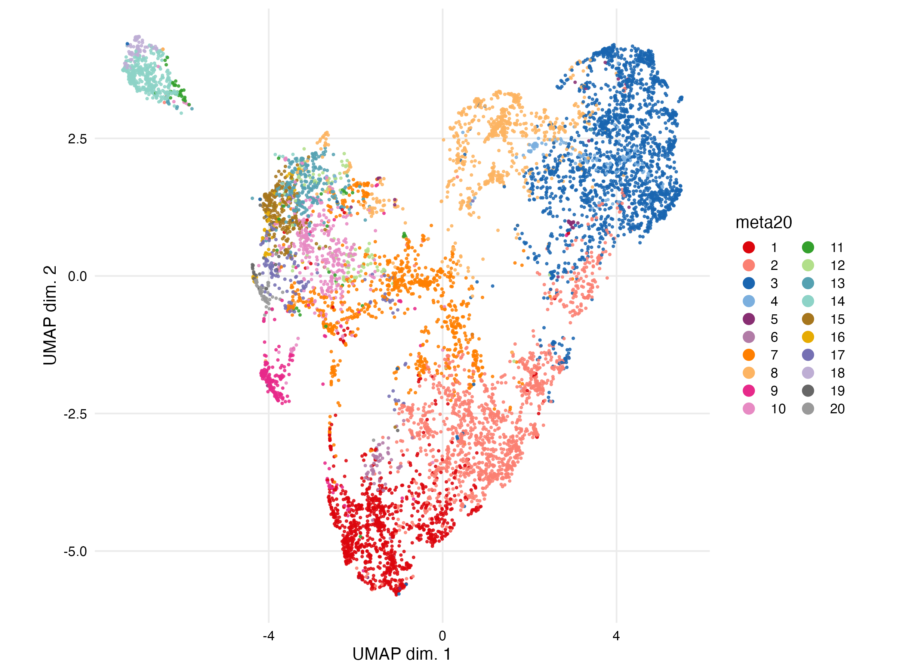
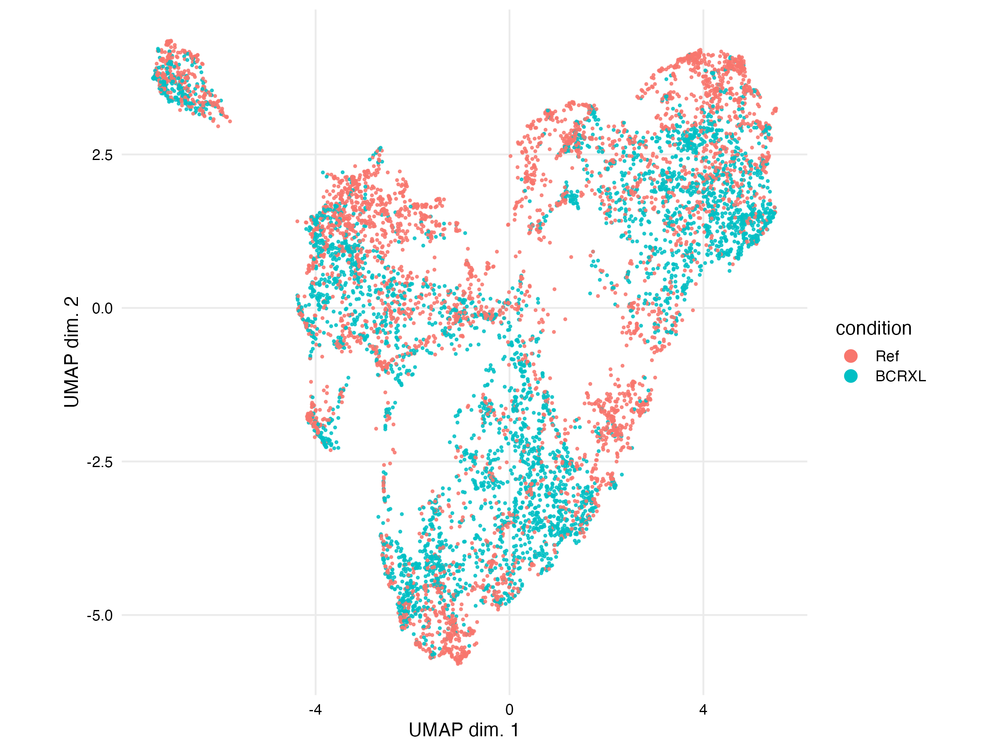
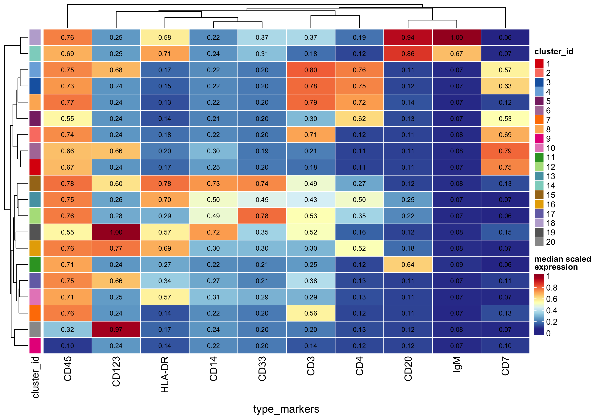
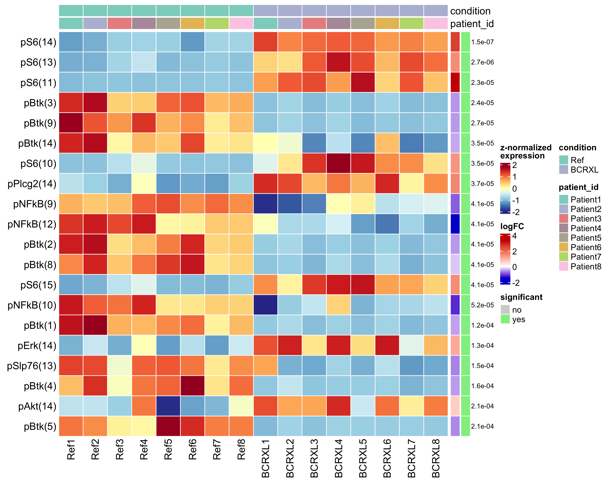

# CyTOF Analysis with CATALYST, FlowSOM and diffcyt

Reproducible reanalysis of public mass cytometry (CyTOF) data using CATALYST, FlowSOM and diffcyt, plus a FlowSOM clustering benchmark against manual gating labels.

This is a methods demonstration on public data. It does not present new biology and does not involve any CyTOF wet-lab or instrument work.

## What this does

1. **PBMC8 (BCR-XL vs. unstimulated, 8 patients, paired design):** QC, FlowSOM clustering with consensus metaclustering, UMAP, differential abundance (DA) and differential state (DS) testing.
2. **Benchmark:** FlowSOM (default parameters, no tuning) vs. manual gating labels on Samusik_01 and Levine_32dim, scored with ARI and one-to-one matched F1.

## Repository layout

```
R/pipeline.R                    # run_pipeline(): QC -> clustering -> UMAP -> DA/DS
scripts/01_catalyst_flowsom.R   # small CATALYST demo dataset (smoke test)
scripts/02_pbmc8_full.R         # full PBMC8 analysis
scripts/03_flowsom_benchmark.R  # FlowSOM vs. manual labels
results/                        # figures and tables
renv.lock                       # pinned package versions
```

## Results

### PBMC8 (BCR-XL vs. unstimulated, 8 patients, paired)

**Setup.** 16 samples (8 patients x unstimulated/BCR-XL). Cells were clustered with FlowSOM (10x10 grid) on 10 type markers (CD45, CD123, HLA-DR, CD14, CD33, CD3, CD4, CD20, IgM, CD7) and consensus-merged into 20 metaclusters. UMAP was computed on a subsample of 500 cells per sample. DA (edgeR) and DS (limma on per-cluster median marker expression, 14 signaling markers) used a paired design (condition + patient); significance threshold FDR < 0.05. Cell counts per sample vary considerably (see `01_counts.png`).

| | |
|---|---|
|  |  |
|  |  |

**Sample-level QC.** In the pseudobulk MDS plot, unstimulated and BCR-XL samples separate mainly along MDS dimension 1 (`02_pbMDS.png`).

**Differential abundance.** 12 of 20 clusters differed between conditions (6 higher, 6 lower in BCR-XL). The largest change was a decrease in cluster 18 (logFC -3.34, FDR 4e-39), a CD20-high / IgM-high cluster, followed by decreases in clusters 12 and 13 (logFC -2.10 and -2.19). Clusters 6 and 19 increased (logFC +1.48 and +1.24). See `results/pbmc8_full/tables/DA_results.csv`.

**Differential state.** 152 of 280 cluster-marker tests (14 markers x 20 clusters) were significant. Higher in BCR-XL: pS6 (18 of 20 clusters), pAkt (17), pErk (13). Lower in BCR-XL: pBtk (19 of 20), pNFkB (18), pSlp76 (17). pStat5 was not significant in any cluster. The largest effects were pS6 in cluster 11 (logFC +3.34) and cluster 14 (+2.60). Most of these changes appear across many clusters, not only B-cell-like ones, so they are reported descriptively and are not assigned to a specific cell type. See `results/pbmc8_full/tables/DS_results.csv`.

### FlowSOM vs. manual gating

FlowSOM (10x10 SOM grid, default parameters, no tuning, seed 1234) was run on all cells. Scores were computed only on cells with a manual label; unassigned cells were clustered but not scored.

| Dataset | Cells (total) | Cells (labeled) | Ref. populations | Setting | ARI | Mean F1 |
|---|---|---|---|---|---|---|
| Samusik_01 | 86,864 | 53,173 | 24 | metaclusters = 24 | 0.60 | 0.62 |
| Samusik_01 | 86,864 | 53,173 | 24 | metaclusters = 40 | n/a | 0.69 |
| Samusik_01 | 86,864 | 53,173 | 24 | 100 SOM nodes | n/a | 0.57 |
| Levine_32dim | 265,627 | 104,184 | 14 | metaclusters = 14 | 0.70 | 0.42 |
| Levine_32dim | 265,627 | 104,184 | 14 | metaclusters = 40 | n/a | 0.72 |
| Levine_32dim | 265,627 | 104,184 | 14 | 100 SOM nodes | n/a | 0.50 |

Mean F1 uses one-to-one matching between reference populations and clusters (Hungarian algorithm); unmatched populations score 0. ARI is reported only when the number of clusters equals the number of reference populations.

Using 40 metaclusters gave the highest mean F1 in both datasets. On Levine_32dim, mean F1 was much lower than ARI when the metacluster count equaled the number of reference populations (0.42 vs. 0.70).

## Data sources

- **Expression data:** HDCytoData (Weber & Soneson, *F1000Research* 2019, 8:1459), hosted on Bioconductor ExperimentHub. PBMC8 data are the Bodenmiller_BCR_XL dataset (Bodenmiller et al., 2012).
- **PBMC8 metadata and panel:** Zenodo record 10039274 (`PBMC8_metadata.xlsx`, `PBMC8_panel_v3.xlsx`), supporting the Bioconductor cytofWorkflow (Nowicka et al., *F1000Research* 2017, 6:748).
- **Benchmark datasets:** Samusik_01 and Levine_32dim from HDCytoData.

## Reproduce

Requires R >= 4.5.

```bash
Rscript -e 'renv::restore()'
Rscript scripts/01_catalyst_flowsom.R     # optional smoke test
Rscript scripts/02_pbmc8_full.R
Rscript scripts/03_flowsom_benchmark.R
```

Outputs are written to `results/`. Data are downloaded automatically on first run and are not tracked in git. Random seed 1234 is used throughout.

## Limitations

- Methods demonstration on public data, not new biology.
- PBMC8 has 8 patients in a paired design, so statistical power is limited.
- PBMC8 clusters are not annotated to cell types beyond marker patterns in the heatmap; no manual gating was done.
- 20 metaclusters is a resolution choice, not a data-driven optimum: the delta-area plot is nearly flat beyond k of about 6.
- DA compares cluster proportions, and BCR-XL can shift marker expression, so a change in a cluster's abundance may partly reflect cells moving between clusters. This was not tested.
- Benchmark evaluation covers manually gated cells only (about 61% of Samusik_01 and 39% of Levine_32dim); unassigned cells were clustered but not scored. Reference labels come from manual gating and are themselves imperfect.
- FlowSOM was run with default settings and a single random seed; differences between settings (for example 0.62 vs. 0.69 on Samusik_01) were not tested for seed-to-seed variability.
- Only FlowSOM was evaluated; there is no comparison with other clustering methods.
- The number of metaclusters (40) was chosen by comparing three preset values on the same labels used for scoring, so the best-setting result is optimistic.

## Environment

R 4.5.2. Package versions are pinned in `renv.lock`.

## References

- Bodenmiller B, et al. Multiplexed mass cytometry profiling of cellular states perturbed by small-molecule regulators. *Nat Biotechnol* 2012.
- Nowicka M, et al. CyTOF workflow: differential discovery in high-throughput high-dimensional cytometry datasets. *F1000Research* 2017, 6:748.
- Weber LM, Soneson C. HDCytoData: Collection of high-dimensional cytometry benchmark datasets in Bioconductor object formats. *F1000Research* 2019, 8:1459.
